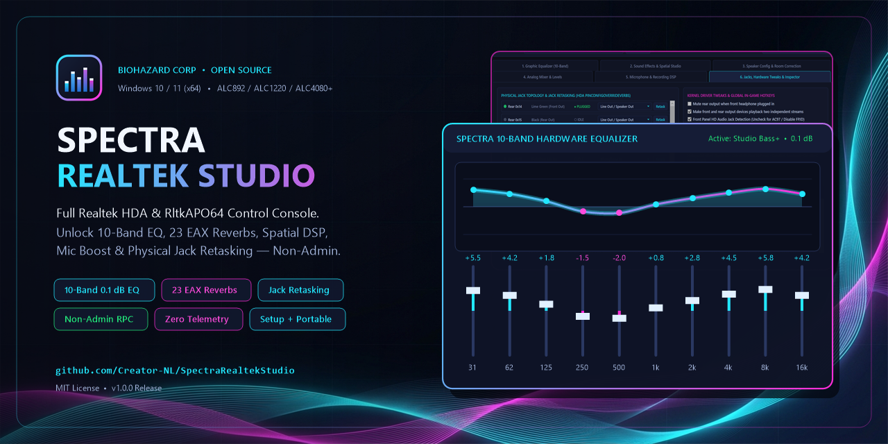
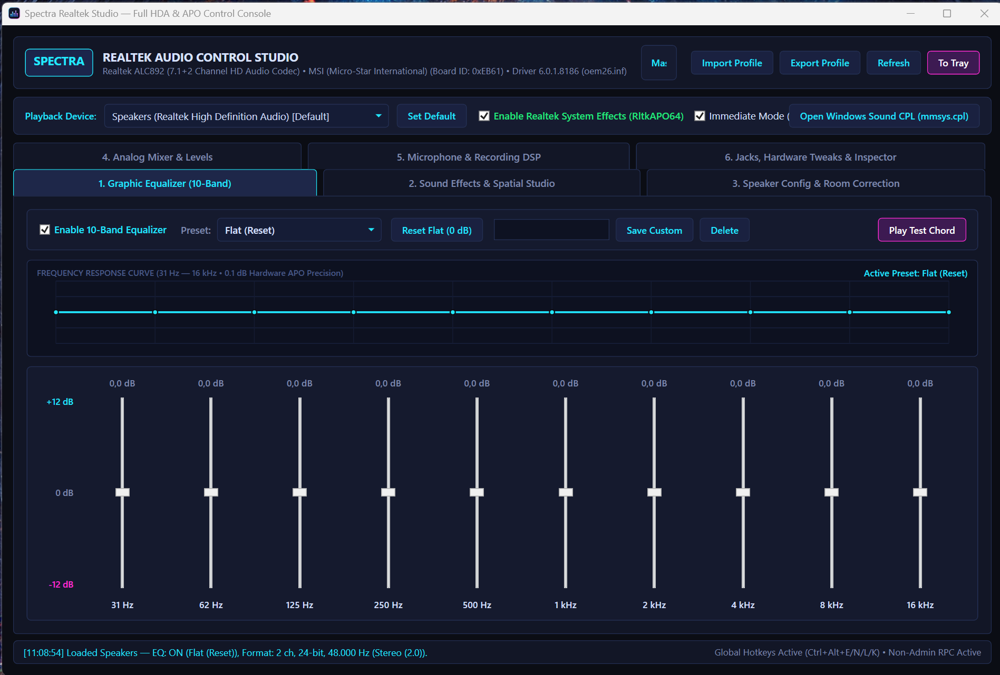
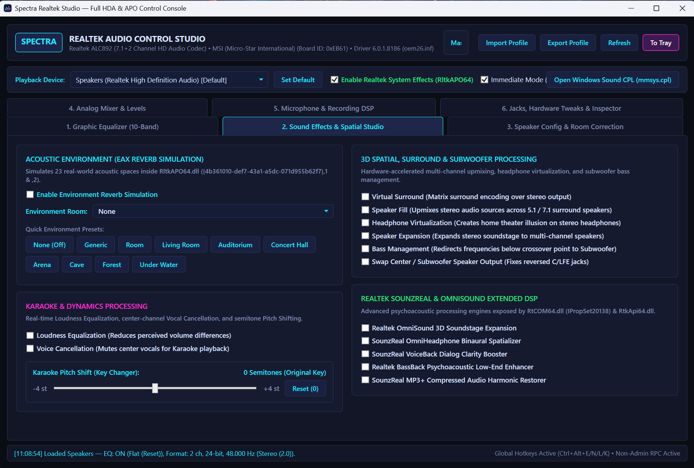
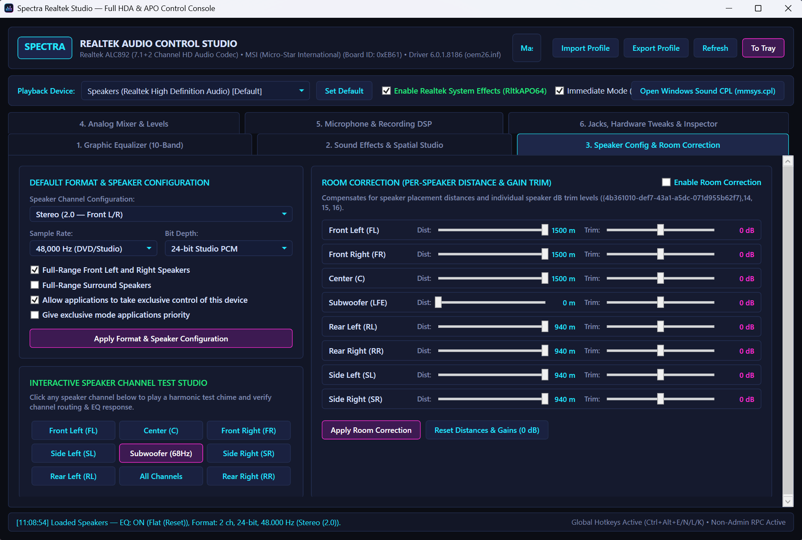
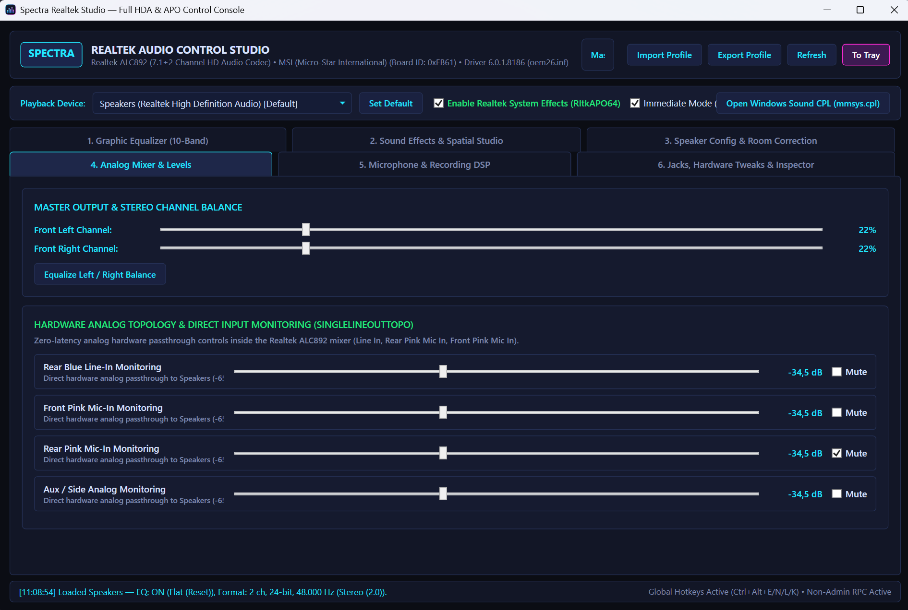
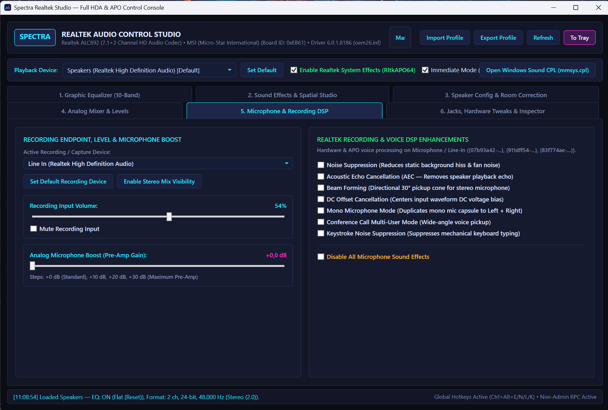
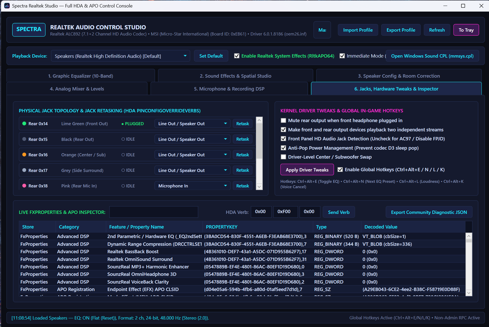
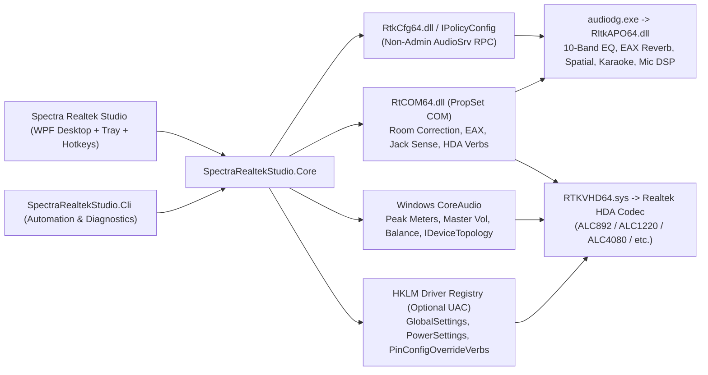

<div align="center">
  
  <br /><br />
  <p>
    <a href="https://github.com/Creator-NL/SpectraRealtekStudio/releases"></a>
    <a href="LICENSE"></a>
    
    
  </p>

  <p><em>Crafted by <a href="https://github.com/Creator-NL">Creator-NL / Biohazard Corp</a></em></p>
</div>

---

## Why Does Spectra Realtek Studio Exist?

Millions of motherboards (**MSI, ASUS, Gigabyte, ASRock, Dell, HP, Lenovo**) ship with **Realtek High Definition Audio** codecs (`ALC887`, `ALC888`, `ALC892`, `ALC897`, `ALC898`, `ALC1150`, `ALC1200`, `ALC1220`, `ALC4080`, etc.) whose drivers include the complete hardware audio engine (`RTKVHD64.sys`) and System Effects APO (`RltkAPO64.dll`), **yet**:

1. The Microsoft Store **Realtek Audio Console** UWP app frequently breaks after Windows or driver updates (`"Cannot connect to RPC service"` or missing settings where the **Equalizer, Environment Reverb, Karaoke, and Room Correction** disappear completely).
2. Classic Realtek HDA driver packages (such as **R282 / R283 / 6.0.1.8186**) dropped the legacy GUI manager while leaving all DSP engines (`RltkAPO64.dll`, `RtCOM64.dll`, `RtkApi64.dll`, `RtkCfg64.dll`) registered and active inside Windows Audio.

**Spectra Realtek Studio** communicates directly with the native Realtek APO and Windows Audio RPC service (`RtkCfg64.dll` / `IPolicyConfig` + `RtCOM64.dll` + CoreAudio `IDeviceTopology`), restoring **every single feature** of your Realtek audio card — faster, cleaner, open-source, **100% offline with zero telemetry**, and **without requiring Administrator privileges for daily use**.

---

## Download & Install (No .NET Installation Needed)

Grab the latest self-contained Windows 10/11 (x64) binaries from the **[GitHub Releases](https://github.com/Creator-NL/SpectraRealtekStudio/releases)** page:

| Package | File | Description |
| :--- | :--- | :--- |
| **Windows Installer** | `SpectraRealtekStudio-v1.0.1-Setup.exe` | Modern Inno Setup 6 installer with Start Menu shortcuts, optional Desktop icon, and optional *Start minimized to tray on Windows sign-in*. |
| **Portable Edition** | `SpectraRealtekStudio-v1.0.1-Portable.zip` | Extract anywhere and run `SpectraRealtekStudio.App.exe` directly — zero installation required! Includes `SpectraRealtekStudio.Cli.exe`. |
| **Checksums** | `SHA256SUMS.txt` | Verified SHA-256 checksums for both packages. |

---

## Screenshots (All 6 Studio Modules)

| 1. 10-Band Graphic Equalizer | 2. Sound Effects, EAX & Spatial Studio |
| :---: | :---: |
|  |  |

| 3. Speaker Config & Room Correction | 4. Analog Mixer & Direct Input Monitoring |
| :---: | :---: |
|  |  |

| 5. Microphone & Recording DSP | 6. Physical Jack Retasking, Tweaks & FxProperties Inspector |
| :---: | :---: |
|  |  |

---

## Architecture Overview



---

## Complete Feature Set

### 1. 10-Band Graphic Equalizer (`31 Hz` — `16 kHz`) & Master Anti-Clip Gain
- **Full `0.1 dB` Hardware Precision**: Controls all 10 Realtek APO bands (`31 Hz` to `16 kHz`) across `-12.0 dB` to `+12.0 dB` with neon Cyan/Silver vertical sliders, double-click band reset to `0.0 dB`, and a live **40-byte `VT_BLOB` hex payload console** (`{4b361010-def7-43a1-a5dc-071d955b62f7},6`).
- **Live Cyan → Violet → Magenta Catmull-Rom Frequency Curve**: Smooth interactive response visualizer with quick one-click preset pill chips (*Flat, Rock, Pop, Bass, Powerful, Club, Live, Vocal, Treble, Classical, Party, Soft, Dance* + unlimited saved custom presets).
- **Master Output Rotary Gain Knob (`-24.0 dB` to `+12.0 dB`) & Auto-Gain Anti-Clip Limiter**: Pre-mix 32-bit float digital headroom (`-24..0 dB`, works even when `RltkAPO64` is bypassed) + configurable `70%–95%` Auto-Gain peak ceiling guard and `OK` / `LIM` / `CLIP` status badge.
- **Settings Menu (`⚙`), Tooltips & Update Checker**: Hover tooltips across every control (toggleable in Settings), live bidirectional Master/Balance volume sync, and manual **Check for Updates...** against GitHub Releases.

### 2. Sound Effects, EAX Acoustic Environment, Karaoke & Spatial Studio
- **23 EAX Acoustic Environment Reverbs**: *Generic*, *Padded Cell*, *Room*, *Bathroom*, *Living Room*, *Stone Room*, *Auditorium*, *Concert Hall*, *Cave*, *Arena*, *Hangar*, *Carpeted Hallway*, *Hallway*, *Stone Corridor*, *Alley*, *Forest*, *City*, *Mountains*, *Quarry*, *Plain*, *Parking Lot*, *Sewer Pipe*, and *Under Water*.
- **Karaoke & Dynamics Studio**:
  - **Voice Cancellation**: Center-channel vocal phase cancellation for karaoke playback.
  - **Pitch Shift (Key Changer)**: Real-time semitone transposition from `-4` to `+4` semitones.
  - **Loudness Equalization**: Dynamic range normalization to balance quiet dialogue and loud peaks.
- **3D Spatial, Surround & Subwoofer Processing**:
  - **Virtual Surround**, **Speaker Fill** (stereo-to-5.1/7.1 upmixing), **Headphone Virtualization**, **Speaker Expansion**, **Bass Management**, and **Swap Center / Subwoofer Output**.
- **Realtek SounzReal & OmniSound Extended DSP**:
  - **OmniSound 3D**, **SounzReal OmniHeadphone**, **VoiceBack**, **BassBack**, and **MP3+ Harmonic Restorer**.

### 3. Speaker Configuration, Default Format & Room Correction
- **Speaker Layout & Studio Format**: Switch between **Stereo (2.0)**, **Quadraphonic (4.0)**, **5.1 Surround (Rear or Side)**, and **7.1 Surround**; configure Sample Rate (`44.1 kHz` to `192 kHz`), Bit Depth (`16-bit` / `24-bit`), Full-Range speaker flags, and Exclusive Mode controls.
- **Interactive 8-Channel Speaker Test Studio**: Individual harmonic chimes for `Front Left`, `Center`, `Front Right`, `Side Left`, `Subwoofer (68 Hz LFE pulse)`, `Side Right`, `Rear Left`, `Rear Right`, and `All Channels`.
- **Room Correction**: Per-speaker distance delay (`0..30 m`) and individual dB gain trim (`-12..+12 dB`) across all 8 surround channels.

### 4. Analog Mixer, L/R Balance & Direct Hardware Input Monitoring
- **Live 30 FPS Stereo Peak Meters (L/R)** and independent Front Left / Front Right channel balance controls.
- **Zero-Latency Hardware Direct Input Monitoring (`SingleLineOutTopo`)**: Direct analog passthrough mixer controls inside the Realtek codec (*Rear Blue Line-In Monitoring*, *Front Pink Mic-In Monitoring*, *Rear Pink Mic-In Monitoring*, *Aux / Side Monitoring*).

### 5. Microphone, Line-In, Stereo Mix & Recording DSP
- Manage all capture endpoints (*Line In*, *Microphone*, *Stereo Mix*), including one-click **Enable Stereo Mix Visibility**.
- **Recording Input Volume & Analog Microphone Pre-Amp Boost** (`+0 dB`, `+10 dB`, `+20 dB`, `+30 dB`).
- **Realtek Voice DSP**: **Noise Suppression**, **Acoustic Echo Cancellation (AEC)**, **Directional Beam Forming**, **DC Offset Cancellation**, **Mono Microphone Mode**, **Conference Call Mode**, and **Keystroke Noise Suppression**.

### 6. Physical Jack Retasking, Driver Tweaks, Global Hotkeys & Inspector
- **Live Jack-Sense & Instant Non-Admin Jack Retasking (`IRtkPropSet20146`)**: Polls physical 3.5mm jacks (`0x14`..`0x1B`) live via kernel KS property, filters per-pin hardware capability bitmasks, supports instant non-admin role retasking with zero reboot plus one-click **Reset Defaults**.
- **Kernel Driver Tweaks (`GlobalSettings` & `PowerSettings`)**:
  - *Mute rear output when front headphone plugged in* (`HpShutsOffRearSpeaker`)
  - *Independent front and rear output streams* (`EnableDynamicDevices`)
  - *Front Panel HD Audio vs. AC97 Jack Detection* (`HpMode` / `DisableFPJD`)
  - *Anti-Pop Power Management* (`IdlePowerState` to prevent codec D3 sleep pop)
  - *Driver-Level Center / Subwoofer Swap* (`CenterLfeSwap`)
- **System Tray Quick-Switcher & Global In-Game Hotkeys**:
  - `Ctrl+Alt+E` — Toggle 10-Band Graphic Equalizer On/Off
  - `Ctrl+Alt+N` — Cycle to Next EQ Preset
  - `Ctrl+Alt+L` — Toggle Loudness Equalization On/Off
  - `Ctrl+Alt+K` — Toggle Karaoke Voice Cancellation On/Off
  - Launch with `--minimized` to start directly in the System Tray.
- **Live `FxProperties` Inspector & Raw HDA Verb Console**: Searchable table of all `FxProperties` and `Properties` values with real-time `PROPVARIANT` decoding and one-click **Community Diagnostic JSON** export.

### 7. Live 60 FPS Audio Visualizer (`5 Hz — 48 kHz`, Up to 256-Band FFT)
- **Zero-Dependency Native WASAPI Loopback + 8192-Point Radix-2 FFT**: Works seamlessly with Stereo, Quad (4.0), 5.1, and 7.1 streams (`44.1–192 kHz`) whether `RltkAPO64` is enabled or bypassed.
- **Selectable Frequency Ranges & Uniform Grid**: `5 Hz – 48 kHz (Full)`, `5 Hz – 24 kHz (Studio)`, `0 Hz – 48 kHz (Linear)`, and `20 Hz – 20 kHz (EQ)` with `64`, `128`, or `256` bands.
- **6 Real-Time Studio Visualization Modes**: *Spectrum Bars (FFT + Peak Hold)*, *Mirror Spectrum Wave*, *Stereo Oscilloscope (L/R)*, *Spectrogram Waterfall (Heat)*, *Stereo Vectorscope (Phase XY)*, and *Radial Cyber Halo (360°)* across 4 neon themes (*Spectra Neon*, *Studio RTA*, *Electric Ice*, *Plasma Fire*).
- **Live Mastering Telemetry & True `0%` Idle Overhead**: Displays Dominant Peak Hz, RMS Loudness dBFS, Stereo Phase Correlation, and WASAPI format — and completely shuts down capture (`0%` CPU) when switching tabs, pausing, minimizing, or sending to tray.

---

## Reverse-Engineered Realtek APO & COM Reference

Documented openly for the Windows audio developer community:

### 1. Non-Admin APO Updates via `RtkCfg64.dll` (`IPolicyConfigClient`)
Direct registry writes to `HKLM\SOFTWARE\Microsoft\Windows\CurrentVersion\MMDevices\Audio\Render\<guid>\FxProperties` fail for standard users (`ACCESS_DENIED`) and do not notify `audiodg.exe`. Instead, `RtkCfg64.dll` registers COM class `{AF099A7C-45D2-4CE6-9327-EEAAB0395444}` (`IPolicyConfigClient` `{D39DFFB3-3F1B-4341-97C3-E8415128A834}`), forwarding `SetPropertyValue(endpointId, keyid=1, ref PROPERTYKEY, ref PROPVARIANT)` over RPC to Windows `AudioSrv` without elevation and immediately triggering `IMMNotificationClient::OnPropertyValueChanged` inside `RltkAPO64.dll`.

### 2. `RtCOM64.dll` (`PropSet` `{C6606CA5-2108-4CAF-8E52-1953F2DBF716}`) Mandatory Initialization Order
Calling `IPropSet20065::VistaGetEqEnable` or any per-device `Vista*` method on a cold `PropSet` COM instance causes an `AccessViolationException` unless initialized in this exact order:
1. Query `IPropSet` (`{CF743829-4C33-457D-82CB-A00DE3308CD5}`) and call `Init(out int hwResult)`.
2. Query `IPropSet20065` (`{3F8F4AEB-9090-4F5B-98F2-000A08FC4A04}`) and call `GetDeviceCount(out uint count)` to populate the internal device array.
3. Query `IPropSet20082` (`{BC057E92-289C-422E-A61A-48462D97E089}`) and call `VistaGetDeviceInfo(index, ...)` to map each `ulDeviceIndex` to its Windows MMDevice ID string.

### 3. Primary Realtek `RltkAPO64.dll` `PROPERTYKEY` Catalog (`{4b361010-def7-43a1-a5dc-071d955b62f7}`)

| PID | `PROPERTYKEY` | Type | Description |
|---:|---|---|---|
| `1` | `{4b361010-def7-43a1-a5dc-071d955b62f7},1` | `VT_UI4` | **EAX Environment Reverb Enable** (`0` = Off, `1` = On) |
| `2` | `{4b361010-def7-43a1-a5dc-071d955b62f7},2` | `VT_UI4` | **EAX Environment Preset Index** (`0` = Generic .. `22` = Under Water) |
| `3` | `{4b361010-def7-43a1-a5dc-071d955b62f7},3` | `VT_UI4` | **Voice Cancellation Enable** (`0` = Off, `1` = On) |
| `4` | `{4b361010-def7-43a1-a5dc-071d955b62f7},4` | `VT_I4` | **Karaoke Pitch Shift Semitones** (`-4` to `+4`) |
| `5` | `{4b361010-def7-43a1-a5dc-071d955b62f7},5` | `VT_UI4` | **10-Band Graphic Equalizer Enable** (`0` = Off, `1` = On) |
| `6` | `{4b361010-def7-43a1-a5dc-071d955b62f7},6` | `VT_BLOB` | **10-Band Equalizer Gains** (`int[10]`, 40 bytes, in `1/100th dB`, `-1200` to `+1200`) |
| `7` | `{4b361010-def7-43a1-a5dc-071d955b62f7},7` | `VT_UI4` | **Loudness Equalization Enable** (`0` = Off, `1` = On) |
| `8` | `{4b361010-def7-43a1-a5dc-071d955b62f7},8` | `VT_UI4` | **Speaker Fill (Multi-Channel Upmix) Enable** |
| `9` | `{4b361010-def7-43a1-a5dc-071d955b62f7},9` | `VT_UI4` | **Virtual Surround Enable** |
| `10` | `{4b361010-def7-43a1-a5dc-071d955b62f7},10` | `VT_UI4` | **Headphone Virtualization Enable** |
| `11` | `{4b361010-def7-43a1-a5dc-071d955b62f7},11` | `VT_UI4` | **Bass Management (Subwoofer Crossover) Enable** |
| `12` | `{4b361010-def7-43a1-a5dc-071d955b62f7},12` | `VT_UI4` | **Speaker Expansion Enable** |
| `13` | `{4b361010-def7-43a1-a5dc-071d955b62f7},13` | `VT_UI4` | **Swap Center / Subwoofer Output Enable** |
| `14` | `{4b361010-def7-43a1-a5dc-071d955b62f7},14` | `VT_UI4` | **Room Correction Enable** |

---

## Command-Line Interface (`SpectraRealtekStudio.Cli`)

```powershell
# Show full hardware, codec, endpoint, EQ, DSP, and physical jack status
SpectraRealtekStudio.Cli.exe status

# Apply any built-in or custom 10-band EQ preset
SpectraRealtekStudio.Cli.exe preset Rock
SpectraRealtekStudio.Cli.exe preset "Flat (Reset)"

# Toggle Equalizer or Loudness Equalization
SpectraRealtekStudio.Cli.exe eq on
SpectraRealtekStudio.Cli.exe loudness on

# Export a full community diagnostic JSON report
SpectraRealtekStudio.Cli.exe diag my_codec_report.json

# Run automated hardware & APO self-verification
SpectraRealtekStudio.Cli.exe test
```

---

## Building & Packaging from Source

Requirements: Windows 10/11 (x64), [.NET 8 SDK](https://dotnet.microsoft.com/download/dotnet/8.0), and optionally [Inno Setup 6](https://jrsoftware.org/isinfo.php).

```powershell
# Build & run unit tests
dotnet build SpectraRealtekStudio.sln -c Release
dotnet test SpectraRealtekStudio.sln -c Release

# Build Self-Contained Installer (Setup.exe) + Portable ZIP + SHA256SUMS.txt
.\build-package.ps1
```

---

## Privacy, Security & Community

- **Privacy:** [docs/PRIVACY.md](docs/PRIVACY.md) — Strictly offline, zero telemetry, zero audio recording.
- **Security:** [SECURITY.md](SECURITY.md) — Responsible disclosure and least-privilege architecture.
- **Accessibility:** [ACCESSIBILITY.md](ACCESSIBILITY.md)
- **Contributing:** [CONTRIBUTING.md](CONTRIBUTING.md) & [CODE_OF_CONDUCT.md](CODE_OF_CONDUCT.md)

---

## License

Released under the [MIT License](LICENSE) — Copyright (c) 2026 Creator-NL / Biohazard Corp.
